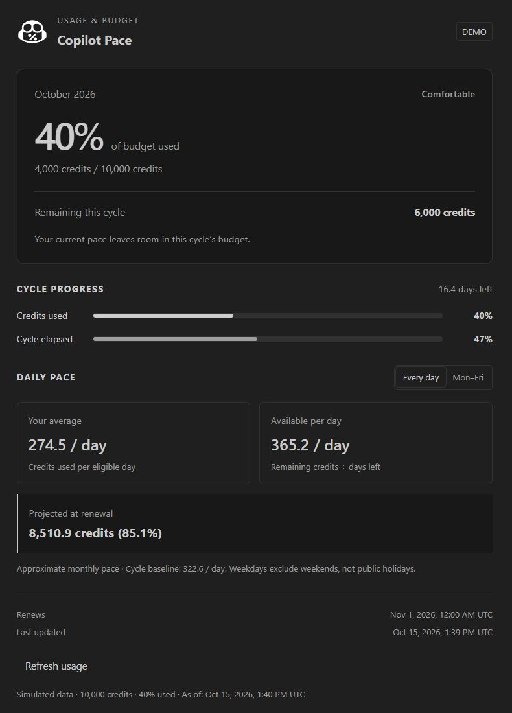
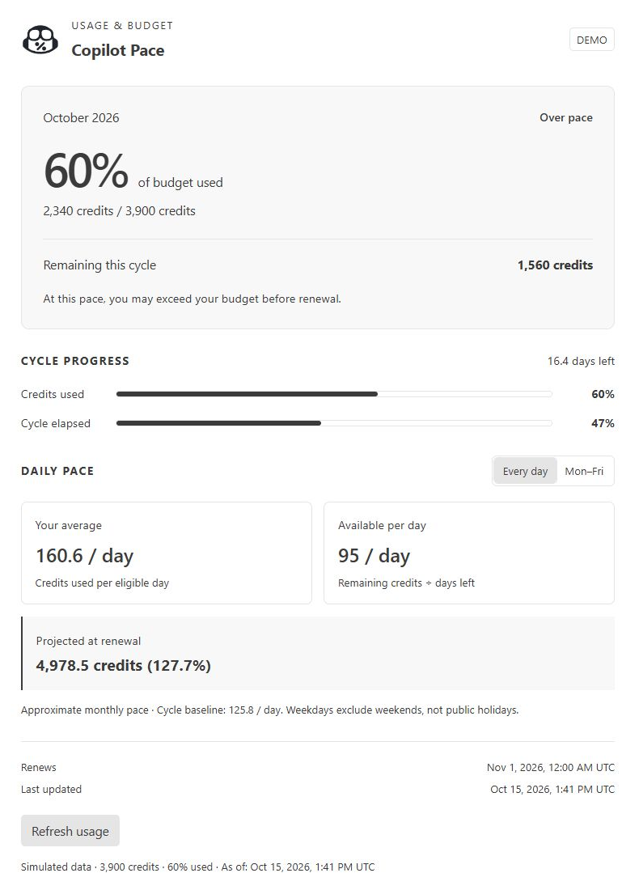

# Copilot Pace

**Know your Copilot budget. Keep your pace in view.**

Track GitHub Copilot credits from your VS Code status bar. See what you have used, what remains, and where your current daily pace could take you by renewal.

**Preview · GitHub.com · Desktop VS Code 1.120+**

[Get started](#get-started) · [Commands](#commands) · [Settings](#settings) · [Report an issue](https://github.com/rublaman/copilot-pace/issues)

## Your usage, at a glance

- **Status bar:** budget used and a color-coded pace indicator while you work.
- **Hover summary:** remaining credits, time left, daily allowance and projected usage.
- **Detail panel:** compare credits used with cycle progress and see the numbers behind the estimate.
- **Flexible calendar:** switch between Every day and Mon–Fri to match your working week.
- **Account controls:** see which GitHub account is being queried, switch accounts or reconnect when needed.
- **Automatic refresh:** check every 15 minutes by default, with a manual refresh whenever you need it.


Hover over the status item for a quick summary. Click it to open the detail panel beside your editor.

## See your pace

The panel puts your remaining budget and daily allowance next to your average consumption. Usage and cycle progress have separate bars, so you can compare how quickly you are spending credits with how much of the cycle has elapsed.

| Comfortable · dark theme | Over pace · light theme |
| --- | --- |
| [](docs/images/details-dark.png) | [](docs/images/details-light.png) |

*Actual extension screenshots with simulated data, captured in the development host. Click either image to inspect it at full size. Demo tools are available only during development; distributed packages use GitHub data.*

### What the colors mean

The status bar color follows **projected usage at renewal**, rather than the percentage already used. In the examples above, 40% used projects to about 85% of the budget; 60% used projects to about 128%.

| Status | Projected usage at renewal | Meaning |
| --- | --- | --- |
| **Comfortable** · green | Below 90% of budget | Your current pace leaves room in the cycle's budget. |
| **On track** · yellow | 90–100% of budget | Your projection is close to the cycle's budget. |
| **Over pace** · red | Above 100% of budget | You may exceed your budget before renewal. |

These are estimates based on your average so far. They change as your usage changes.

## Get started

Copilot Pace is currently distributed through [GitHub pilot releases](https://github.com/rublaman/copilot-pace/releases). Marketplace publication is pending. This README describes the current development version; check a pilot's release notes for the features included in that download.

1. Download the `.vsix` attached to the pilot release you want to try.
2. In VS Code, open **Extensions**, choose **… → Install from VSIX…**, and select the file. Reload an open editor after upgrading.
3. Open the Command Palette (`Ctrl+Shift+P`) and run **Copilot Pace: Connect GitHub**. Authorize access through VS Code.
4. Find Copilot Pace on the right side of the status bar. Hover for a summary or click for details.

You can also install a downloaded package from a terminal:

```powershell
code --install-extension .\copilot-pace-<version>.vsix
```

Replace `<version>` with the version in the downloaded filename.

### Choose the right account

Copilot Pace uses VS Code's GitHub authentication. Its authorization and account selection are separate from Copilot's own connection.

The hover and detail panel identify the account being queried. Use **Switch GitHub account…** to select another account through VS Code, or **Reconnect GitHub** to renew authorization. Copilot Pace shows one account at a time; switching it does not change the account used by Copilot itself.

## Commands

Open the Command Palette and type **Copilot Pace**:


| Command | What it does |
| --- | --- |
| **Copilot Pace: Show Details** | Opens the usage and pace panel. |
| **Copilot Pace: Refresh Usage** | Requests the latest usage for the selected account. |
| **Copilot Pace: Connect GitHub** | Opens the interactive GitHub account flow to connect, switch or reconnect. |

The panel also offers **Refresh usage** and the appropriate account action. **Every day / Mon–Fri** changes the calendar used for the estimate.

## How the estimate works

All amounts represent **credits**. The budget and used percentage come from GitHub's Copilot quota snapshot; Copilot Pace does not guess your budget from a plan name.

| Measure | Calculation |
| --- | --- |
| **Your average** | Used credits ÷ elapsed eligible days |
| **Available per day** | Remaining credits ÷ eligible days left |
| **Cycle baseline** | Budget ÷ eligible days in the cycle |
| **Projected at renewal** | Used credits + daily average × eligible days left |

Calculations use **UTC**, include partial days and require a known budget and a recognized monthly cycle. **Mon–Fri** excludes Saturdays and Sundays, without a public holiday calendar. Before one eligible day has elapsed, the extension shows **Calculating pace**.

## Settings

Search for **Copilot Pace** in VS Code Settings, or edit these application-level settings:

| Setting | Default | Options |
| --- | --- | --- |
| `copilotPace.dayMode` | `"all"` | `"all"` for every day; `"weekdays"` for Monday–Friday |
| `copilotPace.pollIntervalMinutes` | `15` | Automatic refresh interval, from 5 to 120 minutes |

```json
{
  "copilotPace.dayMode": "weekdays",
  "copilotPace.pollIntervalMinutes": 15
}
```

## Privacy

- Authentication stays with VS Code's built-in GitHub provider, using the `read:user` scope.
- Usage requests go directly to GitHub over HTTPS with TLS verification.
- The extension does not read workspace files or conversations, send telemetry, or log tokens or complete response bodies.

## Preview status and compatibility

The current target is **GitHub.com on desktop VS Code for Windows**. Real account and corporate network validation is still pending. GitHub Enterprise Server, GHE.com and browser-based VS Code are unsupported.

Copilot Pace uses an internal GitHub endpoint that may change. Automated checks use synthetic data and do not establish compatibility with an individual plan, account or corporate proxy. Proxy and certificate behavior must be checked in the target environment.

Daily history, individual sessions and usage by model are unavailable.

### When a value is unavailable

- **No known limit / Quota unavailable:** GitHub has not supplied enough information to display a budget or estimate. The extension does not invent missing values.
- **Calculating pace:** wait until one eligible day has elapsed in the recognized cycle.
- **Out of date:** a refresh failed and the last successful snapshot is still displayed. Check the message, then refresh or reconnect as appropriate.
- **Waiting:** GitHub has rate-limited requests. The extension respects the retry delay before trying again.

## Feedback and development

[Report a bug or request a feature](https://github.com/rublaman/copilot-pace/issues). Include the extension version, VS Code version, operating system and steps to reproduce. Remove account identifiers from screenshots and never include tokens or complete API responses.

For local builds, tests and demo scenarios, see [CONTRIBUTING.md](CONTRIBUTING.md). See the [changelog](CHANGELOG.md) for version history and the [release guide](docs/RELEASING.md) for distribution details.

Licensed under [MIT](LICENSE).
