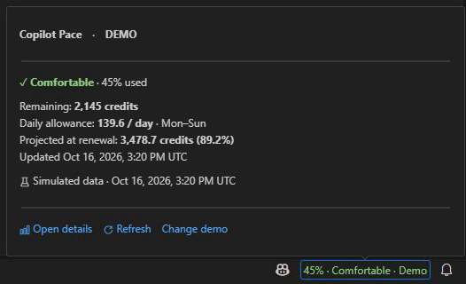

# Copilot Pace

**Know your Copilot budget. Keep your pace in view.**

Track GitHub Copilot credits from your VS Code status bar. See what you have used, what remains, and where your current daily pace could take you by renewal.

**GitHub.com · Desktop VS Code 1.120+**

[Get started](#get-started) · [Commands](#commands) · [Settings](#settings) · [Report an issue](https://github.com/rublaman/copilot-pace/issues)

## Your usage, at a glance

- **Status bar:** budget used and a color-coded pace indicator while you work.
- **Hover summary:** pace status, remaining credits, daily allowance, projected usage and last update.
- **Detail panel:** compare credits used with cycle progress and see the numbers behind the estimate.
- **Consistent pace colors:** green for Comfortable, yellow for On track and red for Over pace in the status bar, hover and detail panel, following your VS Code theme.
- **Flexible calendar:** switch between Every day and Mon–Fri to match your working week.
- **Display language:** English by default, with Spanish (Spain) available from the detail panel.
- **Account controls:** see which GitHub account is being queried, switch accounts or reconnect when needed.
- **Automatic refresh:** check every 15 minutes by default, with a manual refresh whenever you need it.

Hover over the status item for a quick summary. Click it to open the detail panel beside your editor.

<p align="center">
  
</p>

## See your pace

The panel puts your remaining budget and daily allowance next to your average consumption. Usage and cycle progress have separate bars, so you can compare how quickly you are spending credits with how much of the cycle has elapsed.

<p align="center">
  
</p>

*Actual extension screenshots with simulated data, captured from version 1.1.1 in an isolated development host. Both GIFs cycle through Comfortable, On track and Over pace. Demo tools are available only during development; distributed packages use GitHub data.*

### What the colors mean

The color follows **projected usage at renewal**, calculated from your average consumption so far. In these captures, 45%, 50% and 60% used project to approximately 89.2%, 99.1% and 118.9% of the budget respectively. The same used percentage can have a different color at another point in the cycle.

| Status | Projected usage at renewal | Meaning |
| --- | --- | --- |
| **Comfortable** · green | Below 90% of budget | Your current pace leaves room in the cycle's budget. |
| **On track** · yellow | 90–100% of budget | Your projection is close to the cycle's budget. |
| **Over pace** · red | Above 100% of budget | You may exceed your budget before renewal. |

These are estimates based on your average so far. They change as your usage changes.

## Get started

1. In VS Code, open **Extensions** (`Ctrl+Shift+X`) and search for **Copilot Pace** by **Ruben Blanco Manzano**. Select **Install**.
2. Open the Command Palette (`Ctrl+Shift+P`) and run **Copilot Pace: Connect GitHub**. Authorize access through VS Code and select the account with Copilot.
3. Find Copilot Pace on the right side of the status bar. Hover for a summary or click for details.

Version history and tested release packages are available in [GitHub Releases](https://github.com/rublaman/copilot-pace/releases).

### Choose the right account

Copilot Pace uses VS Code's GitHub authentication. Its authorization and account selection are separate from Copilot's own connection.

The hover and detail panel identify the account being queried. Use **Switch GitHub account…** to select another account through VS Code, or **Reconnect GitHub** to renew authorization. Copilot Pace shows one account at a time; switching it does not change the account used by Copilot itself.

## Commands

Open the Command Palette and type **Copilot Pace**:


| Command | What it does |
| --- | --- |
| **Copilot Pace: Show Details** | Opens the usage and pace panel. |
| **Copilot Pace: Refresh Usage** | Requests the latest usage for the selected account. |
| **Copilot Pace: Connect GitHub** | Opens the interactive GitHub account flow to connect, switch or reconnect. |

The panel also offers **Refresh usage** and the appropriate account action. **Every day / Mon–Fri** changes the calendar used for the estimate.

Use **Spanish** in the detail panel's header to switch to Spanish (Spain); the button becomes **Inglés** to switch back. The preference is saved across VS Code restarts and is independent of the editor's display language. Status, hover, panel text, numbers and dates update immediately. The language switch appears only in the detail panel, not in the hover. Calculations continue to use UTC.

## How the estimate works

All amounts represent **credits**. The budget and used percentage come from GitHub's Copilot quota snapshot; Copilot Pace does not guess your budget from a plan name.

| Measure | Calculation |
| --- | --- |
| **Your average** | Used credits ÷ elapsed eligible days |
| **Available per day** | Remaining credits ÷ eligible days left |
| **Cycle baseline** | Budget ÷ eligible days in the cycle |
| **Projected at renewal** | Used credits + daily average × eligible days left |

Calculations use **UTC**, include partial days and require a known budget and a recognized monthly cycle. **Mon–Fri** excludes Saturdays and Sundays, without a public holiday calendar. Before one eligible day has elapsed, the extension shows **Calculating pace**.

The hover reuses **Available per day** as **Daily allowance**, following the selected calendar. It is the sustainable daily average for the remaining cycle, not today's consumption or the average already used. All amounts are credits, not tokens. The quota connection supplies a monthly total without a daily breakdown, even for a connected account, so today's consumption is omitted rather than inferred from the monthly average.

## Settings

Search for **Copilot Pace** in VS Code Settings, or edit these application-level settings:

| Setting | Default | Options |
| --- | --- | --- |
| `copilotPace.language` | `"en"` | `"en"` for English; `"es-ES"` for Spanish (Spain) |
| `copilotPace.dayMode` | `"all"` | `"all"` for every day; `"weekdays"` for Monday–Friday |
| `copilotPace.pollIntervalMinutes` | `15` | Automatic refresh interval, from 5 to 120 minutes |

```json
{
  "copilotPace.language": "en",
  "copilotPace.dayMode": "weekdays",
  "copilotPace.pollIntervalMinutes": 15
}
```

## Privacy

- Authentication stays with VS Code's built-in GitHub provider, using the `read:user` scope.
- Usage requests go directly to GitHub over HTTPS with TLS verification.
- The extension does not read workspace files or conversations, send telemetry, or log tokens or complete response bodies.

## Compatibility

The supported target is **GitHub.com on desktop VS Code for Windows**. The maintainer has validated the 0.2.3 pilot with a real Copilot account, including connection, quota comparison, refresh, details, calendar modes, light/dark themes and persistence after restarting VS Code. Version 1.0.0 retains that runtime behavior.

Copilot Pace uses an internal GitHub endpoint that may change. Validation of one account does not establish compatibility with every plan, multiple-account setup or corporate proxy. Corporate network and certificate configurations require validation in the target environment. GitHub Enterprise Server, GHE.com and browser-based VS Code are unsupported.

Daily history, individual sessions and usage by model are unavailable.

The panel omits model usage because the quota connection supplies no per-model breakdown. GitHub's separate [billing API](https://docs.github.com/en/rest/billing/usage) provides model-level credit quantities with billing access; its [AI usage reports](https://docs.github.com/en/billing/reference/billing-reports) include token counts by model. Neither is integrated here. Saving quota totals locally cannot recover model identities or token counts, and credits are not converted into token estimates.

### When a value is unavailable

- **No known limit / Quota unavailable:** GitHub has not supplied enough information to display a budget or estimate. The extension does not invent missing values.
- **Calculating pace:** wait until one eligible day has elapsed in the recognized cycle.
- **Out of date:** a refresh failed and the last successful snapshot is still displayed. Check the message, then refresh or reconnect as appropriate.
- **Waiting:** GitHub has rate-limited requests. The extension respects the retry delay before trying again.

## Feedback and development

[Report a bug or request a feature](https://github.com/rublaman/copilot-pace/issues). Include the extension version, VS Code version, operating system and steps to reproduce. Remove account identifiers from screenshots and never include tokens or complete API responses.

For local builds, tests and demo scenarios, see [CONTRIBUTING.md](CONTRIBUTING.md). See the [changelog](CHANGELOG.md) for version history and the [release guide](docs/RELEASING.md) for distribution details.

Licensed under [MIT](LICENSE).
