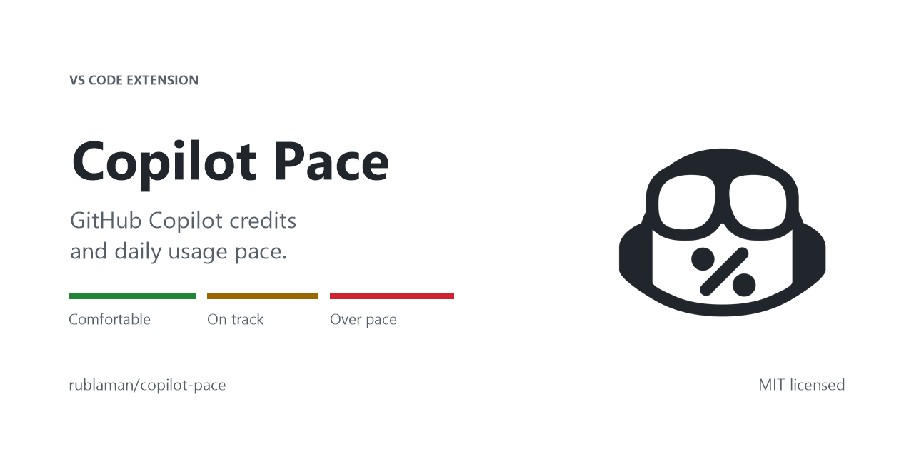
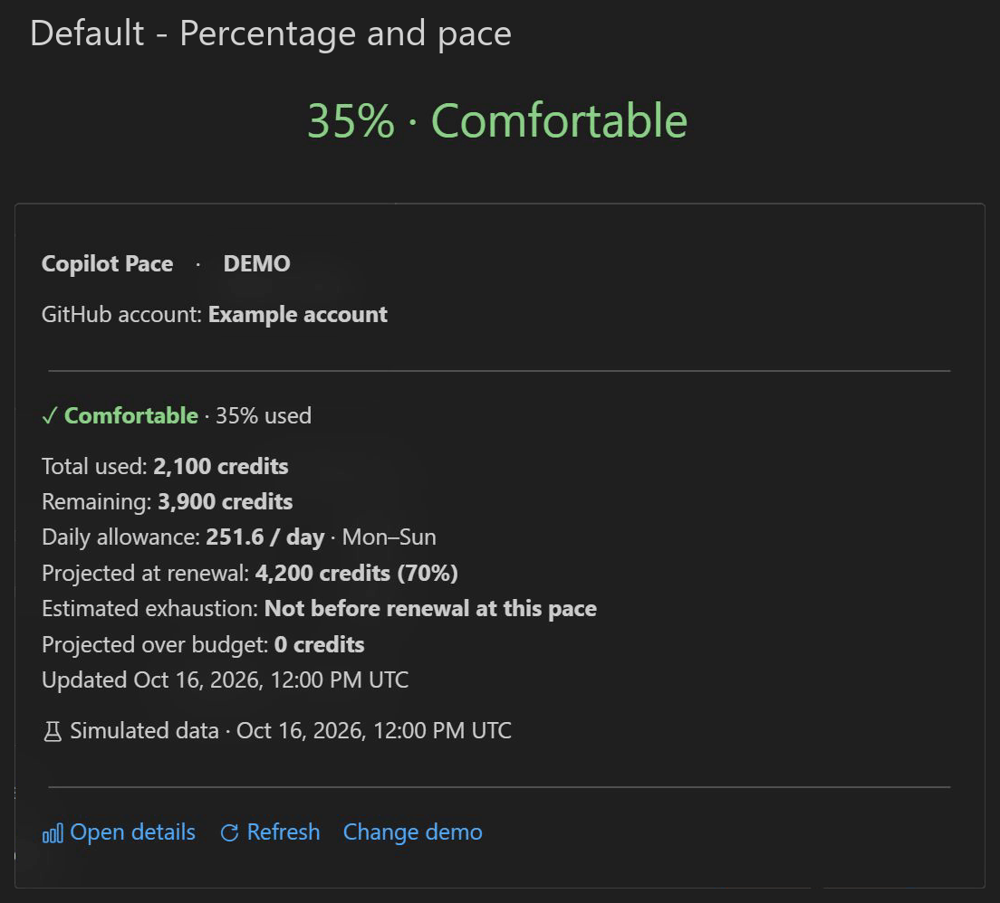
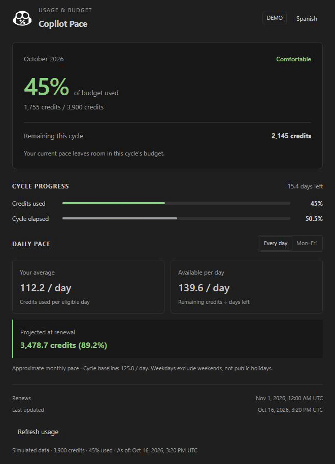
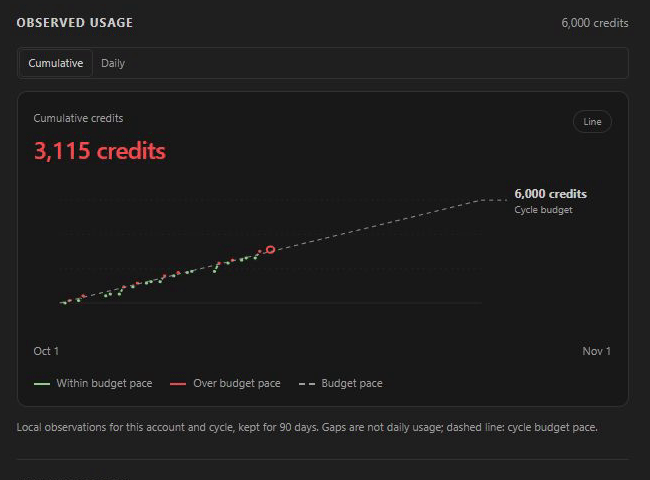
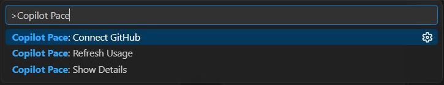

# Copilot Pace

[](https://github.com/rublaman/copilot-pace/releases/latest)
[](https://github.com/rublaman/copilot-pace/actions/workflows/ci.yml?query=branch%3Amain+event%3Apush)
[](https://marketplace.visualstudio.com/items?itemName=rubenblancomanzano.copilot-pace)
[](https://github.com/rublaman/copilot-pace/blob/main/LICENSE)

Copilot Pace is a VS Code extension that displays GitHub Copilot credit usage and estimates consumption at the next renewal. It supports personal and Business accounts on GitHub.com and GitHub Enterprise (GHE) accounts on Windows, with VS Code 1.120 or later.

[Get started](#get-started) · [Commands](#commands) · [Settings](#settings) · [Report an issue](https://github.com/rublaman/copilot-pace/issues)

## Usage

- **Status bar:** percentage and pace, compact icon, segmented bar or dots, with colors based on projected pace.
- **Hover:** selected account, remaining credits, daily allowance, projection and last update.
- **Detail panel:** usage and cycle progress, daily average and allowance, estimated exhaustion, projected excess, renewal date and account controls.
- **Usage history:** cumulative and daily credit charts against the budget pace, separated by account and server.
- **Calendar:** Every day or Mon–Fri, without a public holiday calendar.
- **Language:** English by default; Spanish (Spain) is available in the detail panel.
- **Refresh:** every 15 minutes by default, or manually from the panel or Command Palette.

Hover over the status item for a quick summary. Click it to open the detail panel beside your editor.

### Status bar and tooltip

Choose **Percentage and pace** (default), **Compact**, **Segmented bar** or **Dots** in Customization. The GIF shows all four modes, alternating **Comfortable** (green) and **Over pace** (red) examples, with each indicator above its native tooltip.

<p align="center">
  
</p>

*Illustrative data. Two seconds per mode; eight seconds per loop. [Open the full-resolution GIF](images/status-modes-hd-dark.gif).*

## Detail panel

The panel compares credits used with elapsed cycle time. Daily average, available credits per day and projected usage use the selected calendar.

<p align="center">
  
</p>

*Illustrative usage figures. The detail animation cycles through Comfortable, On track and Over pace.*

### Usage charts

Switch between **Cumulative** and **Daily** usage, and choose **Line** or **Columns** in Customization. The dashed reference shows the budget pace; green and red compare usage with that reference.

<p align="center">
  
</p>

*Illustrative data, including missing days and a partial current day. The final frame uses Mon–Fri.*

### What the colors mean

The color follows **projected usage at renewal**, calculated from your average consumption so far. In the detail animation, 45%, 50% and 60% used project to approximately 89.2%, 99.1% and 118.9% of the budget respectively. The same used percentage can have a different color at another point in the cycle.

| Status | Projected usage at renewal | Meaning |
| --- | --- | --- |
| **Comfortable** · green | Below 90% of budget | Your current pace leaves room in the cycle's budget. |
| **On track** · yellow | 90–100% of budget | Your projection is close to the cycle's budget. |
| **Over pace** · red | Above 100% of budget | You may exceed your budget before renewal. |

## Get started

1. In VS Code, open **Extensions** (`Ctrl+Shift+X`) and search for **Copilot Pace** by **Ruben Blanco Manzano**. Select **Install**.
2. Open the Command Palette (`Ctrl+Shift+P`) and run **Copilot Pace: Connect GitHub**. Authorize access through VS Code and select the account with Copilot.
3. Find Copilot Pace on the right side of the status bar. Hover for a summary or click for details.

You can also download the stable VSIX from [GitHub Releases](https://github.com/rublaman/copilot-pace/releases/latest). In Extensions, choose **Install from VSIX…**, select the file and reload VS Code.

### Choose the right account

Copilot Pace uses VS Code's GitHub authentication and shows the selected account in the hover and detail panel. Use **Switch GitHub account…** to choose another account or **Reconnect GitHub** to renew authorization. This selection is independent of Copilot's account.

By default, Copilot Pace follows Copilot's configured authentication provider and otherwise uses GitHub.com. When a corporate instance is configured, **Connect GitHub** offers **GitHub.com** for personal and Business accounts or **GitHub Enterprise** for GHE accounts. VS Code handles account selection and sign-in. The choice is saved only for Copilot Pace; use `copilotPace.authProvider: "auto"` to follow Copilot again.

For GHE, configure one HTTPS instance address in VS Code's GitHub Enterprise settings, without a login, project or repository path. Recent VS Code versions use `github-enterprise.uris`; older versions use `github-enterprise.uri`.

After changing the Enterprise instance settings, reload VS Code before reconnecting.

To sign out, use VS Code's **Accounts** menu. Pace clears the previous usage when that provider's session changes, then checks for an authorized session without opening a login dialog. If none is available, it shows **Connect GitHub**. If other authorized accounts remain signed in, VS Code may return one of them; check the displayed account or use **Switch GitHub account…** to choose explicitly.

## Commands

Open the Command Palette and type **Copilot Pace**:



| Command | What it does |
| --- | --- |
| **Copilot Pace: Show Details** | Opens the usage and pace panel. |
| **Copilot Pace: Refresh Usage** | Requests the latest usage for the selected account. |
| **Copilot Pace: Connect GitHub** | Opens the interactive GitHub account flow to connect, switch or reconnect. |

The panel also offers **Refresh usage** and the appropriate account action. **Every day / Mon–Fri** changes the calendar used for the estimate.

Use **Spanish** in the **Customization** section below the chart to switch to Spanish (Spain), and **Inglés** to switch back. The saved preference is independent of VS Code's display language. Text, numbers and dates update immediately; calculations continue to use UTC.

Choose **Status bar appearance** in the same section to switch between **Percentage and pace**, **Compact**, **Segmented bar** and **Dots**. These change the indicator you hover over, while its hover retains the usage details. Colors continue to follow projected pace. Errors and pending estimates remain visible in every style.

**Usage chart** selects **Line** or **Columns**. Existing Gradient area preferences display as Line. Use **Cumulative / Daily** above the chart to compare cycle totals or credits consumed per UTC day. In cumulative mode, columns show the last observed account total per day. In daily mode, columns show that day's consumption. The metric and style are saved independently of the status bar appearance.

Green marks values within the budget pace; red marks values above it. Daily charts compare each day with its calendar-adjusted daily budget. Cumulative charts compare usage with the expected budget at that point in the cycle. Lines change color where they cross the dashed reference; columns use the color of their total. Without a known budget, the chart stays neutral. Partial values remain partial regardless of their color.

The dashed reference ends with the cycle budget in Cumulative mode or the average daily limit in Daily mode. Mon–Fri daily charts label the Saturday/Monday transitions with short UTC dates. **Projected at renewal** estimates the total credits used by renewal if your cycle average continues; its explanation appears below the estimate. The status hover also shows total credits used.

Customization provides **Show location** to reveal the most recent observed-usage file in the system file manager, and **Open file** to inspect it in VS Code. This section is hidden without a connected account and reappears after sign-in. Pace stores separate journals per UTC day and VS Code window. Both actions use the active account and remain disabled until a journal exists; file paths are not displayed in the panel.

## How the estimate works

All amounts represent **credits**. The budget and used percentage come from GitHub's Copilot quota snapshot; Copilot Pace does not guess your budget from a plan name.

| Measure | Calculation |
| --- | --- |
| **Your average** | Used credits ÷ elapsed eligible days |
| **Available per day** | Remaining credits ÷ eligible days left |
| **Cycle baseline** | Budget ÷ eligible days in the cycle |
| **Projected at renewal** | Used credits + daily average × eligible days left |
| **Estimated exhaustion** | Last observation + remaining credits ÷ observed daily average, skipping weekends in Mon–Fri mode |
| **Projected over budget** | Projected credits minus budget, with a minimum of zero |

Calculations use **UTC**, include partial days and require a known budget and a recognized monthly cycle. **Mon–Fri** excludes Saturdays and Sundays, without a public holiday calendar. Before one eligible day has elapsed, the extension shows **Calculating pace**.

**Daily allowance** in the hover is the panel's **Available per day**: remaining credits divided by eligible days left. It is an allowance, not today's consumption; use the **Daily** history chart for consumed credits.

The exhaustion estimate uses the cycle average at the last successful observation. It shows **Not before renewal at this pace** when the budget is expected to last, and **Budget already exhausted** when no credits remain. Exhaustion and excess estimates are hidden after a failed refresh. Projected excess is a credit shortfall, not a bill or permission to spend more.

### Usage history

Pace saves successful quota observations in local extension storage and displays the current account's current cycle. **Cumulative** shows recorded account totals. Gaps longer than two hours, downward corrections and budget changes are not connected. The dashed budget line follows the selected calendar.

**Daily** automatically tries GitHub's AI-credit billing API for personal, organization-billed and enterprise-billed accounts using the current session. Billing permissions or company policies can prevent access. Pace then uses differences between nearby observations within the same UTC day, without another login or a data-source setting. Reported days take precedence over local observations; local intervals and the ongoing day are marked **Partial**. Missing days stay empty, and differences across midnight, offline gaps, budget changes or corrections are not assigned to a day. Billing reports can arrive late.

Billing queries are limited to the current cycle and cached in memory. Ambiguous billing accounts and unsupported reports use the observed fallback. The current session is not guaranteed to have billing access, and Pace does not request broader permissions or a separate token. See the [personal and organization API requirements](https://docs.github.com/en/rest/billing/usage) and [enterprise requirements](https://docs.github.com/en/enterprise-cloud@latest/rest/billing/usage).

Account observations can reflect usage from other devices. Daily journals are separated by authentication provider, server and account, and expired journals are removed after 90 days when history is accessed. Demo data is never saved or sent to billing. Storage errors do not prevent quota refreshes. Neither chart attributes consumption to models or projects.

## Settings

Search for **Copilot Pace** in VS Code Settings, or edit these application-level settings:

| Setting | Default | Options |
| --- | --- | --- |
| `copilotPace.authProvider` | `"auto"` | `"auto"` follows Copilot; `"github"` uses GitHub.com; `"github-enterprise"` uses the configured corporate instance |
| `copilotPace.language` | `"en"` | `"en"` for English; `"es-ES"` for Spanish (Spain) |
| `copilotPace.dayMode` | `"all"` | `"all"` for every day; `"weekdays"` for Monday–Friday |
| `copilotPace.statusStyle` | `"text"` | `"text"`, `"compact"`, `"bar"` or `"dots"` |
| `copilotPace.chartStyle` | `"line"` | `"line"` or `"columns"` |
| `copilotPace.chartMetric` | `"cumulative"` | `"cumulative"` or `"daily"`; data-source selection is automatic |
| `copilotPace.pollIntervalMinutes` | `15` | Automatic refresh interval, from 5 to 120 minutes |

```json
{
  "copilotPace.language": "en",
  "copilotPace.dayMode": "weekdays",
  "copilotPace.pollIntervalMinutes": 15
}
```

## Privacy

- Authentication stays with VS Code's built-in GitHub or GitHub Enterprise provider, using the `read:user` scope.
- Usage requests go directly to GitHub over HTTPS with TLS verification.
- The extension does not read workspace files or conversations, send telemetry, or log tokens or complete response bodies.
- Local history stores observation times, credit amounts, known budgets and cycle boundaries under a hashed account/server key. It contains no account labels, credentials, prompts or responses and is not sent by Pace to another service.

## Compatibility

Supports **GitHub.com personal and Business accounts** and **GitHub Enterprise (GHE) accounts** on desktop VS Code for Windows, version 1.120 or later. Enterprise usage queries require a single configured HTTPS instance.

Copilot Pace uses an internal GitHub endpoint that may change. Browser-based VS Code is unsupported.

The quota endpoint provides aggregate credits. Daily billing access is optional and depends on the account, session permissions and API availability. Its new integration has synthetic coverage; real-account billing acceptance is still pending. Pace does not estimate tokens or provide individual-session or per-model analytics.

### When a value is unavailable

- **No known limit / Quota unavailable:** GitHub has not supplied enough information to display a budget or estimate. The extension does not invent missing values.
- **Calculating pace:** wait until one eligible day has elapsed in the recognized cycle.
- **Out of date:** a refresh failed and the last successful snapshot is still displayed. Check the message, then refresh or reconnect as appropriate.
- **Waiting:** GitHub has rate-limited requests. The extension respects the retry delay before trying again.

## Feedback and development

[Report a bug or request a feature](https://github.com/rublaman/copilot-pace/issues). Include the extension version, VS Code version, operating system and steps to reproduce. Remove account identifiers from screenshots and never include tokens or complete API responses.

For local builds, tests and demo scenarios, see [CONTRIBUTING.md](../CONTRIBUTING.md). See the [changelog](../CHANGELOG.md) for version history and the [release guide](RELEASING.md) for distribution details.

Licensed under [MIT](../LICENSE).
